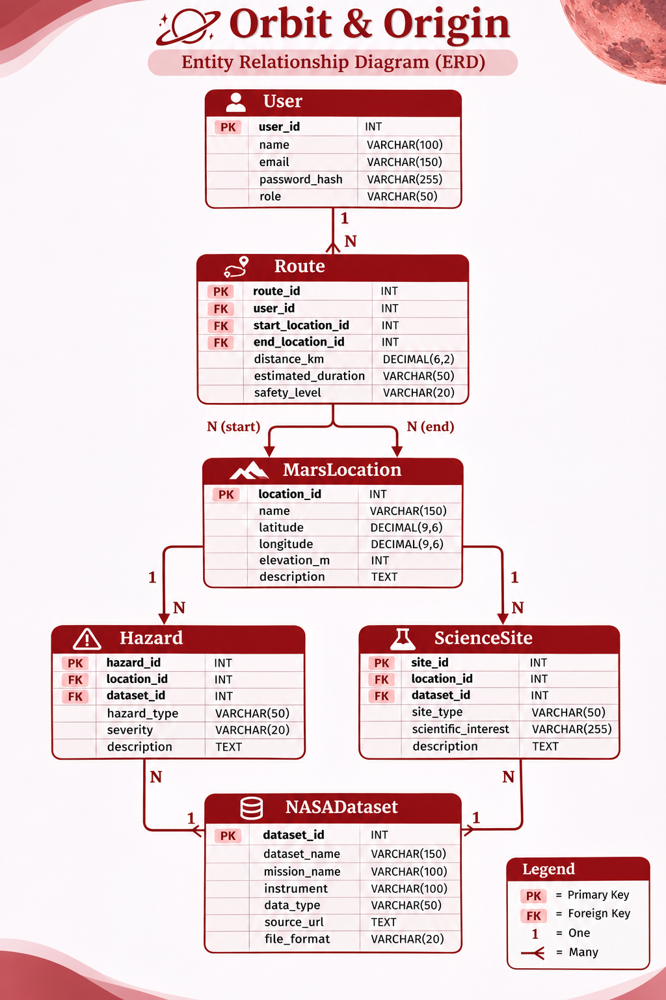

# Orbit and Origin

## Project Overview

Orbit and Origin is an interactive Mars exploration platform designed to help users explore Martain terrain, understand environmental conditions, identify potential hazards, and plan safer routes using integrated data from NASA missions.


## Target Users

| User | Description |
|---|---|
| Mission Planners | Plan and evaluate Mars exploration routes. |
| Astronauts / Explorers | Explore locations and understand potential hazards. |
| Researchers / Scientists | Analyze terrain and scientific locations. |


## Functional Requirements

| ID | Requirement |
|---|---|
| FR-01 | The system shall display an interactive map of Mars. |
| FR-02 | Users shall be able to zoom in, zoom out, and navigate the map. |
| FR-03 | The system shall display different map layers, such as terrain and elevation. |
| FR-04 | Users shall be able to view information about selected locations. |
| FR-05 | The system shall identify and display potential environmental hazards. |
| FR-06 | The system shall display scientific points of interest. |
| FR-07 | Users shall be able to plan routes between selected locations. |
| FR-08 | The system shall evaluate route conditions using available terrain and hazard information. |
| FR-09 | The system shall integrate data from multiple NASA missions. |


## Non-Functional Requirements

| ID | Requirement |
|---|---|
| NFR-01 | The interface should be easy to navigate. |
| NFR-02 | The map should load and respond efficiently. |
| NFR-03 | The system should support integration of additional datasets. |
| NFR-04 | Data should be presented accurately with appropriate sources. |
| NFR-05 | The application should work on different screen sizes. |
| NFR-06 | The system should handle missing or unavailable data gracefully. |


## Project Scope

### Core Features (MVP)

- Interactive Mars map.
- Terrain and elevation layers.
- Location information.
- Hazard visualization.
- Basic route planning.

### Potential Future Features

- Advanced route safety scoring.
- Additional environmental analysis.
- Integration of more NASA datasets.
- Advanced scientific data visualization.

## User Stories

### US-01: Explore Mars

As an explorer, I want to navigate an interactive Mars map so that I can explore different regions of the planet.

### US-02: View Terrain Layers

As a mission planner, I want to switch between terrain and elevation layers so that I can understand the surface conditions.

### US-03: Identify Hazards

As an explorer, I want to view potential hazards on the map so that I can avoid dangerous areas.

### US-04: View Location Information

As a researcher, I want to select a location on the map and view its details so that I can understand its characteristics.

### US-05: View Scientific Locations

As a researcher, I want to identify scientific points of interest so that I can explore locations with potential scientific value.

### US-06: Plan Exploration Routes

As a mission planner, I want to select a starting point and destination so that I can plan an exploration route.

### US-07: Evaluate Route Safety

As a mission planner, I want to evaluate terrain conditions and potential hazards along a route so that I can choose a safer path.


## Initial Acceptance Criteria

| User Story | Acceptance Criteria |
|---|---|
| US-01 | Users can navigate the Mars map and zoom in and out. |
| US-02 | Users can switch between available map layers. |
| US-03 | Potential hazards are visually distinguishable on the map. |
| US-04 | Selecting a location displays its relevant information. |
| US-05 | Scientific points of interest are displayed on the map. |
| US-06 | Users can select a starting point and destination. |
| US-07 | Route conditions and identified hazards are displayed for evaluation. |


## Future Considerations

- Identify and evaluate suitable NASA datasets.
- Finalize the user interface and wireframes.
- Define the system architecture and data models.
- Implement the core features.
- Integrate real NASA datasets and validate results.

# System Design & Data Modeling

**Prepared by: Maryam Aref**

This section describes the main system entities, Entity Relationship Diagram (ERD), relationships between entities, and expected NASA dataset structure.

## Task 1: Main System Entities

### 1. User Entity

**Purpose:** Stores information about registered users.

| Attribute | Description |
|---|---|
| user_id (PK) | Unique user identifier |
| name | Full name of the user |
| email | User's email address |
| password_hash | Securely hashed password |
| role | Astronaut, Researcher, or Admin |

### 2. MarsLocation Entity

**Purpose:** Stores geographical information about Mars locations.

| Attribute | Description |
|---|---|
| location_id (PK) | Unique location identifier |
| name | Name of the location |
| latitude | Latitude coordinate |
| longitude | Longitude coordinate |
| elevation_m | Elevation in meters |
| description | Location information |

### 3. Route Entity

**Purpose:** Stores planned exploration routes.

| Attribute | Description |
|---|---|
| route_id (PK) | Unique route identifier |
| user_id (FK) | User who created the route |
| start_location_id (FK) | Starting location |
| end_location_id (FK) | Destination |
| distance_km | Total route distance |
| estimated_duration | Estimated travel time |
| safety_level | Low, Medium, or High risk |

### 4. Hazard Entity

**Purpose:** Stores information about dangerous areas on Mars.

| Attribute | Description |
|---|---|
| hazard_id (PK) | Unique hazard identifier |
| location_id (FK) | Location of the hazard |
| dataset_id (FK) | NASA dataset used |
| hazard_type | Steep slopes, rocks, etc. |
| severity | Low, Medium, or High |
| description | Hazard information |

### 5. ScienceSite Entity

**Purpose:** Stores scientifically interesting Mars locations.

| Attribute | Description |
|---|---|
| site_id (PK) | Unique scientific site identifier |
| location_id (FK) | Associated Mars location |
| dataset_id (FK) | NASA dataset used |
| site_type | Crater, rock formation, etc. |
| scientific_interest | Scientific importance |
| description | Additional information |

### 6. NASADataset Entity

**Purpose:** Stores information about NASA data sources.

| Attribute | Description |
|---|---|
| dataset_id (PK) | Unique dataset identifier |
| dataset_name | Name of NASA dataset |
| mission_name | NASA mission name |
| instrument | Instrument collecting data |
| data_type | Elevation, imagery, terrain |
| source_url | Link to NASA data |
| file_format | CSV, GeoTIFF, etc. |

**PK:** Primary Key  
**FK:** Foreign Key

**Note:** User accounts and saved routes are optional features. The User entity and Route.user_id are only required if the team decides to implement them.

---

## Task 2: Initial Entity Relationship Diagram (ERD)

The following ERD shows the six main system entities, their primary keys (PK), foreign keys (FK), and relationships.


---

## Task 3: Relationships Between Entities

### 1. User → Route

**Relationship: One-to-Many (1:N)**

| Entity | Key | Relationship |
|---|---|---|
| User | user_id (PK) | One user can create multiple routes. |
| Route | user_id (FK) | Each saved route belongs to one user. |

### 2. MarsLocation → Route

**Relationship: One-to-Many (1:N)**

| Entity | Key | Relationship |
|---|---|---|
| MarsLocation | location_id (PK) | One location can be used in multiple routes. |
| Route | start_location_id (FK) | Starting location |
| Route | end_location_id (FK) | Destination |

### 3. MarsLocation → Hazard

**Relationship: One-to-Many (1:N)**

| Entity | Key | Relationship |
|---|---|---|
| MarsLocation | location_id (PK) | One location can have multiple hazards. |
| Hazard | location_id (FK) | Each hazard belongs to one location. |

### 4. MarsLocation → ScienceSite

**Relationship: One-to-Many (1:N)**

| Entity | Key | Relationship |
|---|---|---|
| MarsLocation | location_id (PK) | One location can have multiple science sites. |
| ScienceSite | location_id (FK) | Each site belongs to one location. |

### 5. NASADataset → Hazard

**Relationship: One-to-Many (1:N)**

| Entity | Key | Relationship |
|---|---|---|
| NASADataset | dataset_id (PK) | One dataset can identify multiple hazards. |
| Hazard | dataset_id (FK) | Each hazard references one dataset. |

### 6. NASADataset → ScienceSite

**Relationship: One-to-Many (1:N)**

| Entity | Key | Relationship |
|---|---|---|
| NASADataset | dataset_id (PK) | One dataset can provide multiple science sites. |
| ScienceSite | dataset_id (FK) | Each site references one dataset. |

### Relationship Summary

| No. | Parent Entity | Child Entity | Type |
|---|---|---|---|
| 1 | User | Route | 1:N |
| 2 | MarsLocation | Route (Start) | 1:N |
| 3 | MarsLocation | Route (End) | 1:N |
| 4 | MarsLocation | Hazard | 1:N |
| 5 | MarsLocation | ScienceSite | 1:N |
| 6 | NASADataset | Hazard | 1:N |
| 7 | NASADataset | ScienceSite | 1:N |

---

## Task 4: Expected NASA Dataset Structure

### 1. NASA Data Information

| Attribute | Description |
|---|---|
| dataset_id (PK) | Unique dataset ID |
| dataset_name | Name of NASA dataset |
| mission_name | NASA mission name |
| instrument | Instrument used to collect data |
| data_type | Images, elevation, terrain |
| source_url | Link to NASA data |
| file_format | JSON, CSV, GeoTIFF, etc. |

### 2. Mars Terrain Data

| Attribute | Description |
|---|---|
| location_id (PK) | Unique location ID |
| latitude | Latitude coordinate |
| longitude | Longitude coordinate |
| elevation_m | Terrain elevation |
| slope_degrees | Terrain steepness |
| surface_type | Rocky, sandy, or flat |
| dataset_id (FK) | NASA dataset used |

These terrain attributes represent a proposed processed-data structure and may be added to MarsLocation or stored separately.

### 3. NASA Data Sources

| NASA Source | Purpose |
|---|---|
| MOLA | Mars elevation and height |
| HiRISE | Detailed Mars surface images |
| CTX | Mars surface maps |
| Mars Rovers | Scientific information and photos |

### 4. Example JSON Structure

```json
{
  "dataset_id": 1,
  "dataset_name": "Mars Terrain",
  "data_type": "elevation",
  "locations": [
    {
      "location_id": 101,
      "latitude": 18.4,
      "longitude": 77.5,
      "elevation_m": -2500,
      "slope_degrees": 8,
      "surface_type": "rocky"
    }
  ]
}
```

**Note:** This is an example of processed data, not an actual NASA dataset response. The values are illustrative.

### 5. How Our Website Uses NASA Data

| Step | Description |
|---|---|
| 1. Collect | Get Mars data from NASA |
| 2. Organize | Store data in the system |
| 3. Display | Show Mars maps and terrain |
| 4. Analyze | Identify hazards and safer routes |

---

## Conclusion

The system design provides the foundation for the Orbit and Origin Mars exploration website.

The proposed entities organize Mars locations, exploration routes, hazards, scientific sites, and NASA datasets.

This initial design may be updated as the team finalizes the website features and selects NASA data sources.
